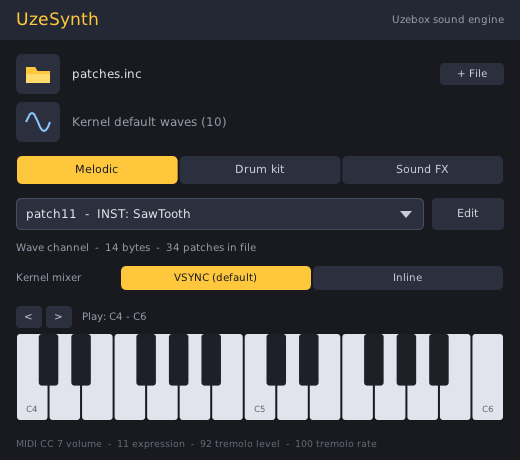
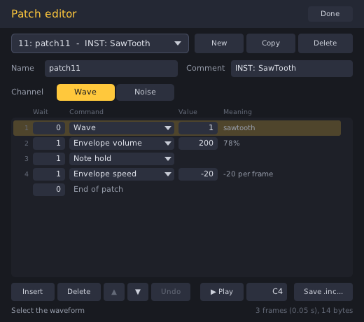

# UzeSynth

An open source synth plugin that emulates the [Uzebox](https://uzebox.org) sound engine.
Load a `.inc` file of Uzebox patches, pick a patch, and play it from your DAW.

It builds as **VST3, VST2, CLAP, LV2** and a **JACK standalone** on Linux, and the same
code targets Windows and macOS (plus **AU** on macOS) through the
[DPF](https://github.com/DISTRHO/DPF) plugin framework. The only dependencies are DPF
(a git submodule) and the system's X11/OpenGL libraries.

## Screenshots






## Features

- **Bit-exact engine.** A line-by-line port of the kernel's `ProcessMusic()`, `TriggerNote()`,
  `TriggerFx()` and patch commands (`uzeboxSoundEngine.c`) and the VSYNC mixer
  (`soundMixerVsync.s`), using the AVR's integer widths and rounding.
  It runs at the console's real mixing rate (15734.26 Hz, 262 samples per 60 Hz frame) and
  is then resampled to your DAW's rate.
- **Patch files.** Reads the C patch files used by Uzebox games and Uzebox Patch Studio,
  including `#define`s, simple expressions and the `PatchStruct` table. The comment above
  each patch is shown as its label.
- **Custom wavetables.** Load the wavetable a game uses with `-DMIXER_WAVES=...`.
- **PCM patches.** Sample-based patches (`PatchStruct` type 2, and type 1 with sample data as
  used by games built with `MIXER_CHAN4_TYPE=1`) play on an emulated PCM channel, including
  loop points, pitch from the step table, and the patch's command stream (envelopes, slides,
  pitch changes). Sample arrays kept in a separate file are found automatically.
- **Integrated patch editor.** Create and edit patches (commands, timing, channel, PCM loop
  points, names and comments), audition them while you edit, and save a ready-to-use `.inc`.
- **Both kernel mixers.** Switch between the default VSYNC mixer and the inline mixer
  (`SOUND_MIXER=1`). They differ in how PCM loops and in the noise channel's output.
- **Three modes:**
  - **Melodic:** the selected patch, MIDI note = pitch.
  - **Drum kit:** MIDI note *n* plays patch *n* on the noise channel, exactly like
    MIDI channel 4 in a Uzebox song.
  - **Sound FX:** MIDI note *n* triggers patch *n* the way a game calls `TriggerFx()`
    (note 80, full track volume, note-offs ignored until the effect ends).
- **Session recall.** The patch file, wavetable and selected patch are stored *inside* the
  DAW project, so sessions still load if the original files move.
- **Kernel MIDI controllers:** CC 7 (track volume), 11 (expression), 92 (tremolo level),
  100 (tremolo rate), plus 120/123 (all sound/notes off).

## Current release requirements

The current github builds will only work on certain OS versions.

The Windows builds require Windows 10 64 bit or newer.

The Apple binaries available on the Releases page are only for Apple Silicon Macs.

The Linux binaries are built with Ubuntu 26.04 currently so if you are running an older
distro you'll probably have to build the plugin yourself. Its a small program so it builds
in no time.

## Building on Linux

Install a compiler, CMake and the X11/OpenGL headers.

| Distro | Command |
|---|---|
| Debian / Ubuntu | `sudo apt install build-essential cmake git pkg-config libx11-dev libxext-dev libxrandr-dev libxcursor-dev libgl-dev libdbus-1-dev` |
| Arch | `sudo pacman -S base-devel cmake git pkgconf libx11 libxext libxrandr libxcursor mesa dbus` |
| Fedora | `sudo dnf install gcc-c++ cmake git pkgconf libX11-devel libXext-devel libXrandr-devel libXcursor-devel mesa-libGL-devel dbus-devel` |

`libdbus-1-dev` is optional. With it, "load file" opens your desktop's native file dialog
through the XDG portal; without it DPF uses its own built-in dialog.

Then:

```sh
git submodule update --init --recursive    # fetches DPF
cmake -S . -B build -DCMAKE_BUILD_TYPE=Release
cmake --build build -j
```

The plugins end up in `build/bin/`. `ctest --test-dir build` runs the tests. To install them for your user:

```sh
mkdir -p ~/.vst3 ~/.clap ~/.lv2 ~/.vst
cp -r build/bin/uzesynth.vst3 ~/.vst3/
cp    build/bin/uzesynth.clap ~/.clap/
cp -r build/bin/uzesynth.lv2  ~/.lv2/
cp    build/bin/uzesynth-vst2.so ~/.vst/
```

`build/bin/uzesynth` is a JACK standalone version.

### Windows

Windows builds use **MinGW-w64**, not Visual Studio: DPF's OpenGL user interface needs the
`GL/glext.h` header, which Microsoft's compiler doesn't include. The easiest way is to
cross-compile from Linux, which is what the GitHub Actions build does:

```sh
sudo apt install mingw-w64 wine64
cmake -S . -B build-win -DCMAKE_TOOLCHAIN_FILE=cmake/mingw-w64-x86_64.cmake -DCMAKE_BUILD_TYPE=Release
cmake --build build-win -j
```

Wine is only used during the build, to run the LV2 generator and the tests. Without it,
everything except the LV2 version still builds. The resulting plugins only need standard
Windows DLLs. On Windows itself, MSYS2's MinGW-w64 environment should also work.

### macOS

Install the Xcode command line tools (`xcode-select --install`) and CMake, then use the
same commands as on Linux. This also builds an Audio Unit (`uzesynth.component`). The
plugins are unsigned, so after copying them into place, clear macOS's quarantine flag, e.g.
`xattr -dr com.apple.quarantine ~/Library/Audio/Plug-Ins/CLAP/uzesynth.clap`.

## Using it

1. Click the **folder** icon and load a patch file, for example a game's `patches.inc`.
   If its patch table refers to PCM sample arrays that aren't in that file, UzeSynth looks
   for them in the other `.inc`/`.h` files in the same folder (and in `data/` and the parent
   folder) and loads those too. If a sample still can't be found, a message tells you which
   one, and **+ File** lets you add the file yourself.
2. Optionally click the **wave** icon to load a custom wavetable. **Default** goes back to
   the kernel's 10 built-in waves.
3. Choose a mode.
   - In **Melodic** mode, pick a patch from the drop-down. You can also scroll the mouse
     wheel over it to step through patches.
   - In **Drum kit** and **Sound FX** modes the drop-down shows which MIDI note plays which
     patch. Note 0 (C-1) is patch 0, just as on the console.

The host's generic parameter view also shows these parameters:

| Parameter | Meaning |
|---|---|
| Polyphony | 1 = one Uzebox track (authentic). 2-8 run several emulated tracks, and their sum is clipped to 8 bits the way the console's mixer clips its channels. |
| Master Volume | The kernel master volume. The default is 0x6f (`DEFAULT_MASTER_VOL`), the level games play at unless they call `SetMasterVolume()`. |
| Output | **Smooth**: band-limited resampling. **Raw**: the stepped 8-bit samples held at your DAW's rate. |
| Mode | Melodic / Drum kit / Sound FX |
| Kernel Mixer | **VSYNC** (the kernel default, also used by PCM games built with `MIXER_CHAN4_TYPE=1` such as Donkey Kong, Space Invaders and Atomix) or **Inline** (`SOUND_MIXER=1`, e.g. Arkanoid and Super Mario, where PCM is a separate 5th channel). Pick the one the game you're writing for uses. |

The keyboard at the bottom of the main page plays notes (in Drum kit and Sound FX modes the
note number is the patch number). Click and drag along it to glide between keys; **<** and
**>** change octave.

## The patch editor

Click **Edit** next to the patch list. It also works with no file loaded: click **New** to
start a patch set from scratch.

- **Patches:** pick one from the drop-down, or scroll the mouse wheel over it.
  - **New** adds a patch at the end of the patch table.
  - **Copy** duplicates the current patch.
  - **Delete** removes it after a second click to confirm. Its slot in the patch table is
    left empty, so the other patches keep their numbers.
- **Name** and **Comment** are typed. Names must be valid C identifiers. A PCM patch's name
  is also its sample array's name.
- **Channel:** Wave or Noise. PCM patches show their sample size and **Loop** start/end
  instead; these turn red if they don't make sense.
- **Command table:** one row per patch command.
  - Each row shows the **Wait** (frames before the command runs), the **Command** (click it to
    choose from all 15 kernel commands), the **Value**, and its **Meaning** in plain words.
  - The last row is the wait before the patch ends.
  - **Insert** adds a row below the selected one, **Delete** removes it, and ▲ ▼ move it.
- **Changing numbers**, three ways:
  - Drag up or down on the value.
  - Use the mouse wheel over it. Hold Shift for steps of 10.
  - Click it, type a value and press Enter.
- **Undo** steps back through your edits (also Ctrl+Z).
- **▶ Play** holds a note while you press it, so `PC_NOTE_HOLD` and release phases can be
  heard. The field next to it sets the note. You can also keep editing with the mouse wheel
  while holding Play.
- **Save .inc...** writes a complete patch file: sample arrays, command streams and the
  `PatchStruct` table named `patches`, ready for `InitMusicPlayer(patches);`.

Edits are part of your DAW project straight away, even before you save. The main page shows
"(edited, unsaved)" until you do.

Saving rewrites the file from the patch data. Comments directly above each patch are kept,
but other text, `#define`s and formatting are not, so save under a new name if you want to
keep the original file as it was.

On Linux, DPF's save dialog needs the XDG desktop portal (the `xdg-desktop-portal` package
plus `xdg-desktop-portal-gtk` or `-kde`, already present on most GNOME and KDE desktops).
Without it, **Save .inc...** saves next to the loaded file as `NAME-edited.inc`, never
overwriting another file, and tells you the path.

Typing into fields needs the host to pass key presses to the plugin window, which some hosts
don't do. Everything except names and comments can be done with the mouse alone.

### PCM patches

A PCM patch plays its sample at the pitch given by the step table, like any other channel:
note 35 (B1) is very close to the sample's natural rate of 15734 Hz, and each octave up
doubles the speed. In **Melodic** mode the MIDI note sets the pitch. In **Sound FX** mode,
as with `TriggerFx()`, PCM patches play at note 80, which is 13.5 times the natural rate;
that is what the console does too, which is why games usually play samples with
`TriggerNote()` instead. **Drum kit** mode always uses the noise channel, as MIDI channel 4
does, so PCM patches only play their command stream there.

The sample's loop runs from `loopStart` to `loopEnd` (byte offsets into the sample).
The two mixers loop differently, and both are emulated exactly:

- **Inline:** when playback passes `loopEnd`, it moves back by the loop length.
- **VSYNC:** it jumps to *(position at the start of the current 60 Hz frame − loop length)*,
  so it can land before `loopStart`.

Where the console would then read bytes outside the sample (neighbouring flash), UzeSynth
plays silence. A one-shot sample (`loopStart == loopEnd`) plays to the end, after which the
VSYNC mixer repeats the last frame's worth of samples, as on hardware; samples normally end
in silence, so this is inaudible.

### Wavetable formats

- **Assembler**, as used with `MIXER_WAVES`: `.byte 0x00,0x03,...` (or `.db`).
- **C arrays:** `const char waves[] PROGMEM = { ... };`. All arrays are joined in file order.
- **Raw binary:** `.raw`, `.bin` or `.pcm` files, 256 bytes per wave.

Each wave is 256 signed 8-bit samples, and up to 256 waves are used. Note that tremolo
modulates with wave 0 of the *loaded* table, exactly as the kernel does.

## Command-line renderer

`build/bin/uzerender` (built along with the plugin) lists the patches in a file, or renders
one patch to an 8-bit, 15734 Hz WAV. The WAV holds exactly the samples a Uzebox writes to
its audio output, which is handy for comparing against cuzebox or real hardware.

```sh
uzerender patches.inc                              # list patch table
uzerender patches.inc patch03 out.wav 60 1.0 127   # note, hold seconds, velocity
uzerender --waves sounds.inc patches.inc 5 out.wav # custom wavetable, patch number 5
uzerender --drum patches.inc 7 hat.wav             # drum kit: patch 7 on noise channel
uzerender --fx patches.inc 1 fx.wav                # as TriggerFx(1, ...)
uzerender patches.inc intro_PCM_Data intro.wav 20  # PCM patch (samples found automatically)
uzerender --add samples.inc patches.inc 7 s.wav    # add a sample file explicitly
uzerender --inline patches.inc 7 s.wav             # emulate the inline mixer
```

## Accuracy notes

These kernel behaviours are reproduced on purpose, even where Uzebox Patch Studio differs:

- Channel volume multiplies note, track, envelope, expression and master volumes in
  sequence, each step with the kernel's `+0x100 >> 8` rounding.
- Each channel contributes `(sample × volume) >> 8`, rounding down like the AVR `mulsu`
  instruction, and the sum is clipped to −128…127.
- Wave position is kept between notes, and only `SetMixerNote` and `SetMixerWave` change it.
- `PC_SLIDE` uses 16-bit signed maths, so slides go down correctly.
- `PC_NOTE_HOLD` pauses the command stream until note-off. Note-off only cuts a note when
  its envelope speed is 0 and it is not being held.
- The noise LFSR follows `soundMixerVsync.s` exactly, including the 7-bit mode bit layout.
- Kernel quirks are kept too: `PC_WAVE 0xff` on the noise channel sets the divider bits,
  and a slide on the noise channel changes the noise generator's settings and shift register.

Deliberate differences from a real console:

- A note-on starts that voice's 60 Hz frame immediately, rather than waiting up to 16 ms for
  the next video frame.
- In mono mode, a note-off only releases the note it belongs to. On the console any note-off
  on the channel affects the playing note, so keep tracks meant for hardware monophonic.
- Patch commands that would read outside the patch or wavetable (out-of-range waves, pitches
  above note 126, loops jumping before the patch start) are clamped or wrapped instead of
  reading random flash. PCM playback outside its sample is silent.
- `PC_WAVE` on a PCM patch is ignored (the kernel would move playback into the wavetable).
- In poly mode each voice is a complete track with its own channel, so you can have more
  than one noise or PCM sound at once, which the console can't.
- The real console's PWM audio output and board filter are not modelled.

## License

GPL-3.0-or-later, the same as the Uzebox kernel it is ported from. The wave and step tables
are taken from the kernel source (© 2008 Alec Bourque). DPF is ISC-licensed.
